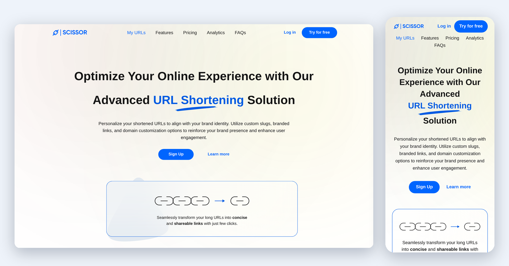

<div align="center">

# Scissor

A responsive landing page for a URL shortening and QR code service.

<a href="https://stormz99.github.io/assessment2/"></a>
<a href="https://www.figma.com/design/Ug5dFpdPeyOy1NNAmZxfov/AltSchoolV2-Exam?node-id=1-448&t=mm6ilGIybcyKjDEI-0"></a>

<br><br>

<a href="https://stormz99.github.io/assessment2/"></a>

</div>

## About

Scissor is a landing page converted from a Figma design into plain HTML and CSS, built one section at a time and fully responsive. It was my AltSchool assessment.

## Sections

1. Header and hero
2. Stats
3. Why choose Scissors
4. Pricing
5. URL form
6. FAQs
7. Get Started banner
8. Footer

## Built with

- HTML5
- CSS3, using custom properties, Flexbox and Grid
- Plus Jakarta Sans from Google Fonts, standing in for Gilroy

The FAQs use `<details>` and `<summary>`, so there is no JavaScript on the page.

## Responsive behaviour

| Width            | Changes                                                                            |
| ---------------- | ---------------------------------------------------------------------------------- |
| 1300px and below | Tighter spacing in the stats band                                                  |
| 1160px and below | Stats stack into a single column with the numbers in two columns                   |
| 1130px and below | Pricing cards stack, footer links turn into a two-column grid                      |
| 1000px and below | Navigation wraps under the logo, hero and features stack, the card sits full width |
| 600px and below  | Smaller headings, stacked buttons and form fields, tighter banner and footer       |

## Project structure

```
assessment2/
├── index.html
├── styles.css
├── README.md
└── assets/
    ├── Logo.svg
    ├── logo-dark.svg
    ├── Hero_section.svg
    ├── Desktop_-_11.svg
    ├── FAQs.svg
    ├── Group_3.svg
    ├── Vector_2.svg
    ├── Vector_3.svg
    ├── Frame_1000001716.svg
    ├── Frame_1000001695.svg
    ├── Group_6.svg
    ├── Ellipse_2.svg
    ├── link-2.svg
    ├── grid.svg
    ├── edit.svg
    ├── activity.svg
    ├── check-blue.svg
    ├── check-white.svg
    ├── chevron-down.svg
    ├── magic-wand.svg
    ├── plus.svg
    ├── minus.svg
    ├── i_fi-social-twitter.svg
    ├── svg_feather.svg
    ├── linkedin.svg
    ├── facebook.svg
    └── preview.png
```

## Running locally

```bash
git clone https://github.com/Stormz99/assessment2.git
cd assessment2
open index.html
```

On Windows or Linux, open `index.html` directly in a browser.

## Notes

- Gilroy is a paid font, so text can wrap slightly differently from the Figma.
- The check marks, chevron, plus and minus, magic wand, LinkedIn, Facebook and the dark logo were not in the Figma export, so I added them myself.
- Most links point to `#` for now.
- Only the first FAQ answer comes from the design. The other answers and the `scissor.link` option in the form are placeholders.

## Deployment

The site is hosted on GitHub Pages at [stormz99.github.io/assessment2](https://stormz99.github.io/assessment2/).
